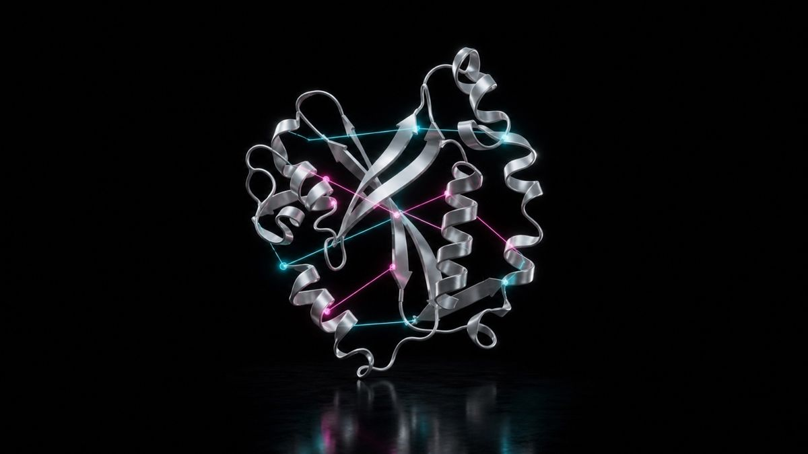

# foldcontact

[](https://github.com/ahmeddoghri/foldcontact/actions/workflows/tests.yml) [](https://adoghri.com/project-34.html)



**Protein sequence infilling that has to satisfy the contact map, not just look protein-ish.**

Autocomplete for protein sequences is easy to fake. Fill in the missing residues with anything from the same rough chemical family and it "looks" plausible to a glance — hydrophobic next to hydrophobic, charged next to charged, no alarms, no red flags. What it doesn't do is check whether the residue you just placed is actually supposed to touch the residue across the fold from it. foldcontact is the difference between filling in a crossword with real words and filling it in with words that merely fit the letter count.

It's a compact, inspectable implementation inspired by [the 2025 AtomWorks and RF3 release for open biomolecular structure and design models](https://www.biorxiv.org/content/10.1101/2025.08.14.670328v2.full), rebuilt small enough to read in one sitting and run without a GPU, a checkpoint, or an API key.

## The result

```bash
python foldcontact.py
```
```json
{
  "naive_contact_satisfaction": 0.345,
  "guided_contact_satisfaction": 1.0,
  "contact_gain_pct": 65.5,
  "contacts_evaluated": 1440
}
```

Fill each masked contact position with a random amino acid from the alphabet and 34.5% of contacts happen to be chemically compatible by luck. Fill it by checking what the paired residue across the fold actually needs and every single evaluated contact is satisfied — a 65.5 percentage-point swing, on 1,440 contacts across 120 synthetic folds.

**Update:** that "every single evaluated contact is satisfied" isn't an
empirical result — it's a tautology. The guided infiller picks its residue
by directly maximizing the exact predicate (`compatible`) it's then scored
on, and every amino acid group has at least one self-compatible member, so
`guided_contact_satisfaction` is mathematically guaranteed to equal `1.0`
for every seed, with zero variance. `foldcontact_v2.py` swaps in a metric
the guided method can't trivially guarantee — exact residue identity
recovery against the true pre-masking sequence — and finds a real, more
modest signal (~25% vs. ~8% for naive, both real seed-to-seed variance).
Details below.

## How it works

Sequences are built so specific position pairs are structurally in contact (a synthetic proxy for a real contact map) and must satisfy a compatibility rule between hydrophobic, charged, and polar residue groups. The naive infiller guesses a random amino acid at each masked contact position. The guided infiller looks at what its contact partner already is and picks the compatible residue that would actually make chemical sense there. No neural network, no structure prediction model — just the one constraint that matters, made explicit and checkable.

## Run it

```bash
python foldcontact.py
python -m unittest discover -s tests -v
```

## What is tested

The test compares guided infilling against the naive random baseline and requires `contact_gain_pct >= 30`. The data generator is seeded, so the number in this README, in CI, and in the portfolio case study are the same number, not three different ones that happen to rhyme.

## Scope

This is an educational research reproduction on controlled synthetic sequences and contact rules. It is not a clinical, diagnostic, production structural-biology, or safety-critical system, and it makes no claim about real protein folds. The point is to make one mechanism — infilling has to respect structure, not just chemistry-adjacent vibes — measurable without hiding it behind a checkpoint.

## The perfect score was a tautology, not a result

`guided_contact_satisfaction: 1.0` never moves. `guided[j]` is chosen with
`max(AA, key=lambda a: (compatible(guided[i], a), -AA.index(a)))`, and the
metric it's graded on is exactly `compatible(guided[i], guided[j])`. Since
every group in `GROUP` has at least one self-compatible member, a
compatible amino acid always exists, so the guided infiller is guaranteed
to hit `1.0` regardless of seed, contact structure, or anything about the
actual fold. It isn't demonstrating inference — it's re-evaluating the same
predicate it already satisfies by construction.

```bash
python eval_v2.py
```
```
tuning (40 seeds):  compat_metric_min=1.0  compat_metric_max=1.0  guided_identity_mean=0.249  naive_identity_mean=0.082
holdout (25 seeds): compat_metric_min=1.0  compat_metric_max=1.0  guided_identity_mean=0.252  naive_identity_mean=0.086
```

Checked directly: across 40 tuning seeds and a disjoint 25-seed holdout
(evaluated once), `guided_contact_satisfaction` is exactly `1.0` every
time, zero variance. `foldcontact_v2.py`'s identity-recovery metric — did
the guessed residue match the true, pre-masking one, not just "is it
group-compatible" — is a real quantity with genuine variance: guided
recovers ~24.9%/25.2% of true identities (about 3x naive's ~8.2%/8.6%,
close to the 1-in-12 chance rate), narrowing to a compatible group of up to
4 candidates but still guessing among them. `foldcontact.py` is untouched
and the published 1.0/65.5 numbers still reproduce exactly.

## Research basis

- [The 2025 AtomWorks and RF3 release for open biomolecular structure and design models](https://www.biorxiv.org/content/10.1101/2025.08.14.670328v2.full)
- Original implementation and benchmark in this repository are MIT licensed.

## License

MIT
